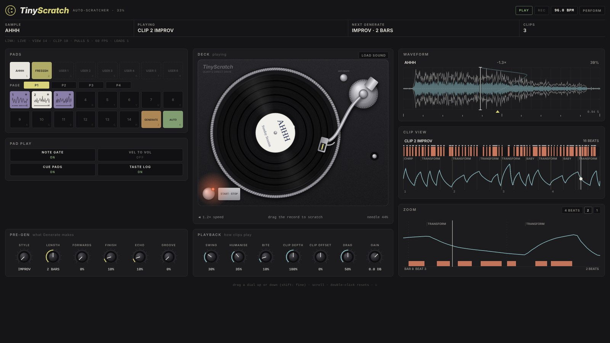

# TinyScratch

**A generative auto-scratcher for the Ableton Move** (a Schwung sound generator). Press a pad and it writes a new, human-sounding turntable
scratch for your sample, plays it in time with your song, and lets you keep the ones you like.

## Install

Install `TinyScratch.tar.gz` from the [releases page](https://github.com/fleshinachair/TinyScratch/releases) with Schwung's module manager
(Install Custom Module, From GitHub URL, `fleshinachair/TinyScratch`), then load TinyScratch in a track slot as a sound generator.
Ahhh and Fresssh come with it, and three clips each.

## Getting started

**1. Open the Pads screen.** Select TinyScratch as a sound generator, **touch the first dial** (knob 1) and **press the jog wheel**. The
Pads screen opens full screen and the pads light up (Back leaves it):

| row (from the top) | pads |
|---|---|
| 1 and 2 | **clips 1 to 14**, then **Generate** (orange) and **Auto** (green) |
| 3 | the eight samples: **Ahhh**, **Fresssh**, **User 1 to 6** |
| 4 | eight red pads: the fader (and, with no clip playing, **cues**: see below) |

**2. Generate a scratch.** Press the **Generate** pad. A new clip plays at once; press it again for another. (Ahhh and Fresssh each
come with three clips on pads 1 to 3 to start with.) Press play on the Move if nothing is sounding: clips follow the transport. The eight dials of the Pads screen are in the order they read: **Style** (Improv, Baby, Cuts,
Flare, ...) and **Length** (1, 2 or 4 bars), then how it plays, **Drag** and **Humanise**, then what Generate adds, **Groove**, **Echo**,
**Forwards** and **Finish**. Touch one to see its name and value. Whenever a clip plays, its style is on the bottom line next to its
number (**CLIP 3 BABY**), and bottom right says which of Echo, Forwards and Finish are really in it, or nothing if it has none. (Echo scratches only appear in Improv.)

**3. Keep it.** Tap an **empty clip pad** while the generated clip is playing. It stays on that pad for that sample, and **Auto** (which
plays each clip right through, from its start, then a random other one) will include it.

**4. Delete it.** Hold a clip pad for a second and a half (a bar fills the screen and the pad goes red). **Any clip can be deleted**,
including the ones that come with the module. The other pads stay where they are.

**More clips: pages.** Each sample has **four pages of 14 clip pads**. Press **>** and **<** (the Move's right and left arrow buttons)
to turn the page: only the 14 clip pads change, everything else stays as it is. A clip keeps playing on its own page while you look at
another (its page mark, top right, blinks), a tap plays the clip of the page you are on, and **Auto** plays the clips of every page.
Each page has its own colour, and a clip on another page than the first is labelled with its page (CLIP 2.3).

**5. Add your own sample.** Best at one to two seconds, noisy and aggressive, with a little silence at each end.

- **Record it:** hold an **empty User pad** (row 3) and make the sound into the Move's input; let go and it is kept (up to ten seconds).
  It is cropped to the sound and brought up to the level of the built-in samples. Recording starts once the pad has been held a moment
  (0.3 s): a tap on an empty User pad just selects it. A recording with no sound in it is not kept.
- **Or load a file:** pick **Load Sample** in the first menu and choose a `.wav` from the Move's library.
- **Remove it:** hold its pad for a second and a half. The clips you kept for it go with it.

Then generate and keep scratches for it, exactly as above. Every sample has its own pages of clip pads.

## Playing

- **Press play and the clip plays; stop and it stops.** The red pads are the crossfader on top of it: **hold one and the sound cuts out**.
- **Transport stopped:** hold a red pad and the clip plays, with its own cuts, until you let go.
- **Cue pads** (a **Clip** of Off, with **Cue Pads** on, which it is): the red pads change colour and become eight cues. Each drops the
  needle on an attack of the sample (the start of its sound, a new word, the next hit) and plays on at the sample's own speed for as long
  as you hold it. A sample with fewer than eight attacks is shared out evenly. A turn of the Turntable dial takes over the playhead, and
  when you let go it plays on from where you left it. Tick marks under the waveform show where the cues are. To get to Clip Off, tap the
  **Auto** pad again.
- **Turn the jog wheel right** for a zoomed view of the clip (4, 2 or 1 beats); left zooms back out.
- Any note from C3 up also cuts the sound in, so you can play it from the Move's sequencer.

## The pages and dials

Turn the jog wheel to move between the pages: the picture, then **Main** (the generator), **Playback**, **Pad Play** and, always last,
the **Waveform**.

**Main: the generator.** Dial 1 opens the Pads screen and dial 2 is **Load Sample**; dials 3 to 8 shape what Generate makes next (a kept
clip never changes):

| dial | what it does |
|---|---|
| **Style** | what Generate makes: **Improv** (the default: an improvised two-bar phrase of strokes of every length, answered by a changed version of itself; it does not pick from the named styles) or one of Baby, Cuts, Military, Scribble, Stab, Chirp, Transform, Flare, Crab, Orbit, Drag, Tear, Stutter |
| **Length** | 1, 2 or 4 bars |
| **Forwards** (0%) | how often a clip lets the record go through most of the sample, so the word is heard |
| **Finish** (10%) | how often a clip ends with the whole sample played through at its own speed, then a quick shut pull back, the way a DJ ends a phrase |
| **Echo** (10%) | how often a bar holds an echo scratch: a short stab four times over two beats, each at a lower fader level |
| **Groove** (0%) | how far **Improv** keeps to a drum groove (see below); 0% is Improv exactly as it was. It leaves room for a beat, so on its own a clip with Groove up can sound thin; over a song it sits in the gaps. It does nothing to the named styles |

**Playback: how clips play.** These change how a clip sounds as it plays, never the clip itself:

| dial | what it does |
|---|---|
| **Swing** (30%) | each pair of sixteenths long-short instead of even: 67% is a triplet feel (the first takes two thirds of the eighth), 100% a hard, dotted swing (three quarters) |
| **Humanise** (35%) | loosens a clip the way a hand would. At 100% the timing drifts by up to 60 ms either way (a new drift every beat), each cut lands up to 25 ms early or late and softer (down to 55% of its level), and each stroke runs up to 8% of the sample short or long. Every pass round the clip is different. At 0 it plays exactly as written. **You can see it:** with Humanise up, the clip view draws what is played as the line and the blocks, and the path as written as a dotted ghost with ticks for its cuts |
| **Bite** (10%) | soft saturation of the sound as it plays, for a raw edge that cuts through a dense mix. It bites harder on a fast stroke and for a few milliseconds as the fader opens, and it lifts the highs (above about 1.8 kHz) going in, so the clipping makes them harder and the sound brighter (about 4 to 8 dB more of the energy up there on the built-in samples at 100%). It comes out denser and louder (about 3 to 4.5 dB at 100%) with the peaks brought down, which is what lets a sound through a dense mix and what you can hear on a noisy sample such as Ahhh. At 100% it is very aggressive (what it adds is as loud as the sound itself); 50% is about as strong as 100% used to be. At 0 the sound is clean |
| **Clip Depth** / **Clip Offset** | how far the clip moves the playhead (0-200%) and where along the sample it moves it: a smaller or shifted version of every clip |
| **Drag** | how quickly the playhead follows: low is "digital", high is "analogue" |
| **Gain** | -24 to +12 dB |

**Pad Play: how the pads play.** **Note Gate** (on: the red pads are the fader; off: you always hear the playhead), **Vel to Vol** and
**Cue Pads** (below), and **Taste Log** (on). Lock, Normalise, Cut From and Pad Grid keep their defaults.

**Taste Log** is for a future feature (a generator that learns what you like from the clips you keep and pass over). **It is on by
default, but nothing uses it yet, and it never leaves your Move: TinyScratch does not send it or ask for it.** Switch it off here if you
would rather not keep it. On, it appends a line to `taste_log.csv` in the module's folder each time you keep a clip,
press Generate again without keeping one (passed over), or delete a clip you kept: its style, length and settings, the seed, how long
it played, and 14 numbers measured from the clip (how busy, how big the strokes, how much is cut in). No audio, sample name or clip data.
Nothing reads it or sends it anywhere. Delete the file to clear it. It is kept to about 800 kB in all.

**Two things are fixed, not dials, because they follow how the real thing works.** The **fader** opens and closes in 1 ms: a scratch DJ sets
the crossfader curve very steep, so it acts as an on-off switch (Hansen). And playback is **anti-aliased**: each sample is kept with copies at
half, a quarter and an eighth of its rate (made when it loads), and a stroke faster than the sample's own speed reads the copy that fits,
so the highs do not fold back as a hiss when the record is pushed at several times its speed, and the top goes as it does on a record.
At its own speed or slower nothing changes. The built-in samples are mid-range noise, so it changes them very little (about half a dB at the
top); it matters for bright sounds such as hi-hats and sibilants, and for your own recordings.

**On the Pads screen all eight dials are in use**, in this order: 1 Style, 2 Length, 3 Drag, 4 Humanise, 5 Groove, 6 Echo, 7 Forwards,
8 Finish. (Load Sample, Swing, Bite and the other settings are on the module's own pages.)

## How the generator works

Generate makes a **recipe** (sample, style, seed, length, and the dial settings) and builds the clip from it, so the same recipe always
gives the same clip. A kept clip is saved exactly (its playhead path and fader), so it sounds the same whatever the generator becomes later.

- **Improv** is a two-bar phrase of strokes of every length, then the same phrase again with some strokes changed, on the sixteenth grid at
  any tempo up to 120 bpm. The fader is laid on the grid and the record turns a little ahead of the beat, so every cut bites in with the
  record already moving fast. **On a faster song** (above 120 bpm) the strokes and the cuts keep the length in seconds they have at 120, so
  there are fewer to the bar: no more sounds a second (about 6.5) than a hand can make, however fast the song. (At 160 bpm the plain grid
  made 8.6 a second, with strokes up to five times the sample's own speed.)

- **It looks at the sample.** It finds the attacks (the start of the sound and any strong rise out of a real dip) and starts each bar's strokes
  just inside one, because a DJ puts the record where the sound bites.
- **Mostly sound, not silence.** Each clip is measured as it is made; a seed that comes out too quiet for its style is thrown again.
- **Tuned to real scratching.** Open about half the time, about 5.7 sounds a second, strokes about half the sample long, forwards on beat 3
  or 4, most of the record's turns hidden by the fader. The sources are Kjetil Falkenberg Hansen and Roberto Bresin,
  [Analysis of a genuine scratch performance](https://www.speech.kth.se/~hansen/files/thesis/HansenBresin03_GW.pdf) (2004), and Hansen's thesis
  [The acoustics and performance of DJ scratching](https://www.speech.kth.se/~hansen/files/thesis/KjetilFalkenbergHansen_2010_phdthesis.pdf)
  (2010). The example clips used for measuring are not in this repository and nothing of them is copied; only the measures were used.
  What was not matched: the real DJ's strokes are not constant in speed (the platter turns in an arc).

**The named styles** are built from the definitions in the Turntablist Transcription Methodology
([TTM basics](https://www.ttm-dj.com/ttm-01-01-basics/), [the TTM guide](https://lcme.uwl.ac.uk/media/tmpfvcmu/ttm-guide-may-2021.pdf)) and
Hansen's descriptions. Each keeps the fader it is defined by, and its strokes and fader move together ("Improv" is the only one laid on the
sixteenth grid):

| style | what it is |
|---|---|
| **Baby** | the record rubbed back and forth, smoothly, with no fader at all: open all the way, the turns heard (now and then a shark-tooth stroke) |
| **Cuts** | the forward cut: pushed forward, then the fader shuts for the pull back |
| **Military** | forward cuts interspersed with rubs, a marching rhythm that gathers speed: the strokes get shorter through the bar |
| **Scribble** | a very quick baby on a small part of the record: a fingertip vibrating on a spot, about twelve times a second whatever the tempo, in bursts |
| **Stab** | a short, quick push at a constant speed, so a higher pitch, the pull back silent |
| **Chirp** | a quick baby with a click at each turn, so each stroke is a note of its own |
| **Transform** | a slow stroke with the fader closed, tapped open in a rhythm |
| **Flare** | a baby, open at the top and bottom, with a click in the middle of the push and of the pull (a 2-click flare, four sounds) or in only one of them (a 1-click flare, three) |
| **Orbit** | the 2-click flare, round and smooth |
| **Crab** | three or four fast clicks (about sixteen a second) in one record gesture, the pull back silent |
| **Drag** | slow strokes, low in pitch |
| **Tear** | the record hand alone, the fader open: pushed forward, stopped, pushed forward again, stopped, then the same backwards: four sounds, two forward and two back (Hansen's "clover tear") |
| **Stutter** | a word's first sound pushed again and again in time, then the word let go: "f-f-f-f-fight". Each push is a forward over the first 50 to 85 ms of the word, the fader open on the push and shut on the pull back; the release glides on through the whole word at about its own speed. One of six rhythms a bar: a run of sixteenths into a roll (pushes each split into two sounds by the fader, as a DJ plays a fast "ffff"), a call and answer ("f-f-fight, f-f-fight"), a build-up that shows a little more of the word each time ("f, fi, fig, figh, fight"), an off-grid pattern, rubs (the record back and forth with the fader open, both ways heard, a baby scratch) then the word let go, or the word first and the stutter after. Its lengths are in seconds, so it works the same on a short clip of one word and on a long phrase (each bar on one of its words). It is played straight and firm: **Drag** does not soften its pushes (each would be a slow run-up, and the whole a robot), and **Swing** and **Humanise** do not bend its timing (a word is cut in at a steady speed, so it stays clear). Best on speech |

The Hansen & Bresin measurements describe one DJ's improvisation, which is what "Improv" follows. The named styles follow the textbook
techniques. Not yet built: the hydroplane. A style's number is saved in a clip's recipe, so new styles are added on the end.

The clips are stored in `recipes.txt` and `kept.bin` in the module's folder, so every new instance of the module starts with the same clips
on the same pads. Clips can also be imported from an Ableton Live Pack you own (`python tools/import_clips.py "your pack.alp"` writes
`local/clips.bin`, which stays out of the repository because it is someone else's work); imported clips can be deleted like any other.

**Groove.** A scratch DJ playing over a beat does not scratch at random: strokes land on the snare or just ahead of a hit, the kick is
left clear now and then, there are rests, a phrase ends in a fill, and the bars do not all say the same. Each Improv clip is given one
drum groove (picked from its seed) on the sixteenth grid, where the kick and the snare fall in a bar:

| groove | kick | snare |
|---|---|---|
| Boom-bap | 1, the "and" of 3 | 2, 4 |
| Four on the floor | every beat | 2, 4 |
| Breaks | 1, the "and" of 2, the "and" of 3 | 2, 4 |
| Half-time | 1, the "and" of 3 | 3 |
| Funk | 1, the "a" of 1, the "and" of 3 | 2, 4 |
| Dembow | every beat | the "a" of 1, the "and" of 2, the "a" of 3, the "and" of 4 |
| Open | 1 | 3 |

The **Groove** dial says how far the clip keeps to it. At 0% nothing changes. As it goes up the strokes tend to end where the groove
wants one (the snare, a step ahead of a hit), the fader is shut on the kicks more often (more at 100%: in tests about seven kick steps in ten
are left empty, against one in six), a quiet bar can follow a busy one (the bars breathe, build or drop), and the last beat of each
phrase becomes a fill of sixteenths. No two clips are alike at any setting.

**Groove leaves room for a beat.** On its own a clip with Groove up can sound thin, because the gaps it leaves are where the drums of a song would be; over a
track it sits in them. Keep it at 0% for clips that should stand alone, and judge it over music. The seven grooves are standard patterns, not the
song's own drums, so some fit a track better than others. A clip made with Groove shows it on the bottom line with its percentage and the groove it kept to
(GRV60 FUNK; BOOM, FLOOR, BRKS, HALF, FUNK, DEMBO or OPEN). With the Taste Log on, each clip's groove is recorded.

## Samples

`samples/ahhh.wav` and `samples/fresssh.wav` ship with the module: the two classic scratch sounds turntablists use as their basic tools,
from the end of "Change the Beat" (Fab 5 Freddy, 1982), described as public domain (see `samples/CREDITS.txt`). **User 1-6** start empty.

- **Recording** is cropped (the press and let-go of the pad are not listened to, and silence at either end goes), faded in and out so the
  cut does not click, and brought to about -14 dBFS with a soft limiter. It is kept as `user1.wav` .. `user6.wav` in the module's
  `samples/` folder.
- **Unloading** deletes a recording or a file you picked. A file you copied into `samples/` yourself is never deleted, only listed in
  `unloaded.txt` so it is not loaded again. Ahhh and Fresssh cannot be unloaded.
- **Copying files** into `samples/`: any `.wav` (16-bit, mono or stereo, any rate, up to ten seconds) fills the User slots that are left.
- A kept clip is rebuilt from its recipe against the same sample if its data is missing, so unload a sample before putting a different one
  in its slot.
- **Long samples** (over 1.2 s: a phrase, a run of words, a loop) are scratched the way a DJ works a phrase. Each bar of a generated clip
  starts on one of the sample's words or hits, and its strokes are as long in seconds as on a short sample (a quarter to a third of a turn),
  not a sweep through the whole phrase. **Clip Depth** turns the strokes up or down around where each bar starts, so a clip turned down
  stays on its words; a built-in clip on a long sample is scaled down the same way. **Finish** plays the phrase from the bar's word to its
  end, at up to twice its own speed. Ahhh, Fresssh and anything up to 1.2 s are not touched by any of this: they and their clips sound
  exactly as they always have.

`tools/audio_convert.c` (`scripts/build_converter.sh`) converts FLAC / WAV / AIFF / MP3 to that format and can cut a one-second excerpt.

## The screens

The first page is the picture: the sample's name, the waveform with the playhead through it, a vinyl that turns as the playhead crosses
the sample, and the clip along the bottom (the playhead's path as a line, the cuts as blocks, a cursor for now). The last page,
**Waveform**, is the sample on its own at full size, with the playhead's speed (1.0X is the sample's own pitch). **Pads** (touch knob 1, press the jog wheel) is the
first picture full screen with the pads coloured: red cuts (cue colour when they are cues, white while held), yellow samples, violet clips
(white for the one picked, green for the one playing in Auto), green Auto, orange Generate.

The Move turns a pad press into a note by its own octave and transpose, so the notes a module hears move about. While the Pads screen is
open it is told which pad was pressed, so the pads are always this grid, and the notes the pads send are ignored. When it closes, every pad
is repainted with the colour the Move itself had. **Pad Grid** (on) makes notes 36 to 99 a grid of eight to a row, counting from the
bottom left, for playing the pads without the Pads screen.

## The Remote UI

Open **http://move.local:7700/remote-ui** in a browser on the same network, with TinyScratch in a track's synth slot, and the module has a
page of its own (Schwung's Remote UI shows it in place of the plain list of controls):

- **The deck:** a turntable seen from above. The record turns with the playhead, at 33 1/3 when it plays the sample at its own speed,
  backwards when the scratch goes back; the platter spins while the Move's transport runs.
- **The graphs**, at full size: the **Waveform** (with where the clip is sending the playhead, the cues, and a trail of where it has
  been), the **Clip View** (the playhead's path and the cuts, the cuts as tall as the fader opens, so an echo steps down; with Humanise
  up, what is played this pass over the path as written), and the **Zoom** (4, 2 or 1 beats scrolling past now). Both can name each stroke
  by its shape, as the turntablists do (baby, chirp, transform, flare, stab, drag, tear, fwd, scribble): what the fader does over it,
  read from the path. They describe the clip, not how it was made: Improv is its own way of writing, not the named styles knitted
  together, but its strokes have these shapes too. STROKES on the clip view switches them off.
- **The pads**, at the top: the samples, the clip pads of the page the Pads screen shows (each with a small picture of its clip), Generate
  and Auto (hold a clip a second and a half to delete it). On a computer, the keys play them: 1 to 8 the samples, Q to I and A to H the
  clips, Space or J Generate, K Auto, the arrow keys the pages.
- **Load a sound**: drop any audio file on the deck (or press LOAD SOUND). The page makes it a mono WAV of up to 10 s, cut to its
  first sound, puts it in the Move's sample library (Samples/TinyScratch) and loads it onto the selected User slot (the first empty one
  when Ahhh or Fresssh is selected).
- **Pick from a song**: a file longer than 10 s (a whole song, an MP3 is fine) opens the picker instead. It shows all of the song and a
  closer view of part of it (scroll to zoom, drag the whole-song view to move along). Mark up to six spots: drag across a word, or choose
  a LENGTH (1, 2, 3, 5 or 10 s) and click where a spot should start. SNAP TO HITS starts each on the nearest word or hit. Drag a spot to
  move it, or its edges to trim it, or type its length. Play each one to hear exactly what will be sent, and give each a User slot and a
  name. Nothing reaches the Move until **SEND**: then each spot becomes a WAV in the sample library and is loaded into its slot. The
  song itself stays in the browser. The spots are ordinary samples once loaded, so they work on the Move without the Remote UI too.
- **Scratch the record**: grab the vinyl and turn it. The playhead goes where your hand takes it (a turn at 33 1/3 is the sample at its own
  speed) and the fader is open while your hand is on; let go and the clip takes over again. You hear it after the network's delay.
- **The dials**, along the top and grouped as the pages are: **Pre-Gen** (Style, Length, Forwards, Finish, Echo, Groove), **Playback** (Swing, Humanise,
  Bite, Clip Depth, Clip Offset, Drag, Gain) and **Pad Play**. Drag up or down (Shift for fine), scroll, or double-click to reset.

On a wide screen (1400 px and over, or the pop-out window) it lays out in three columns: the pads and Pad Play; Pre-Gen over the deck; Playback over the graphs.
**PERFORM** (top right) shows only the deck, big pads and the zoom, full screen where the browser allows it (the pop-out window does).

The host sends the page what it shows twice a second, so between those it plays the clip itself, on the beat clock the DSP sends, through
the same Swing, Depth, Offset and Drag: the record moves with the sound, not half a second behind it. The line under the title says
whether the page is hearing from the Move (**LINK: LIVE**), how many updates have arrived, the frame rate, and any error. When the
Move stops sending on its own, the page asks for them (**PULLS** counts how often).

## Credits

**The look and workflow are inspired by the Live Scratcher module by Andrew Norris** (a sample, clips on the pads, a fader you
cut with). TinyScratch is an independent project, written from scratch. The generator is TinyScratch's own: its vocabulary comes from scratch notation (the Turntablist Transcription Methodology,
TTM), and it was tuned against published measurements of real scratching and overall statistics of example clips.

## Licence

TinyScratch's code is released under the [MIT licence](LICENSE). The two sample clips, Ahhh and Fresssh, are described in
`samples/CREDITS.txt`; clips you import from a Live Pack are someone else's work and are not covered.

## Development

    scripts/test.sh                   engine + plugin tests (UBSan, leak and overrun checks), the screen test, and the Remote UI in a browser
    scripts/build_demo.sh             the Remote UI as a page of its own, playing a recording of the engine (build/demo/), with sound
    scripts/build.sh                  aarch64 dsp.so + build/tinyscratch-<version>.tar.gz
    scripts/install_move.sh           build, copy to the Move over SSH, verify, restart
    scripts/fetch_audition_samples.sh public-domain samples of your own to try as a User sample (samples_audition/, gitignored)
    tools/import_clips.py             reads clips from an Ableton Live Pack you own into local/clips.bin
    help.json                         the on-device help (Schwung's Help viewer, and the Module Help row on this module's pages)

- The DSP serves the screens one JSON string, `view`; `scratcher.js` and `waveform.js` are canvas scripts that only draw it.
- The Remote UI (`src/web_ui.html`) reads three more, `rview` (live: the playhead, the clock, the status), `rclip` (the clip at 64 points
  to the beat and the waveform at 512 columns) and `rpads` (the shapes of the clips on the pads). It writes `scratch` (a hand on the
  record) and `rui_pull` (ignored: any write makes the host send the values again). They are named as `viz.extra_keys` of the hidden View parameter, which is what makes the
  host's extras pump send them (a declared parameter is read only every few seconds); nothing on the Move reads them.
  `tests/remote_ui_test.mjs` plays a recording of the engine (`tools/remote_demo.c`) to the page in Chromium and holds where it draws
  the record to where the playhead really was.
- `module.json` is generated from the plugin's parameter table (`scripts/gen_manifest.sh`) so the two cannot drift.
- Every setting is kept with the project. The host's tempo and beat position drive the clips; the DSP sends no MIDI.
- Files are read only when the module starts and written only when you record, unload, keep or delete, never on the audio thread.
